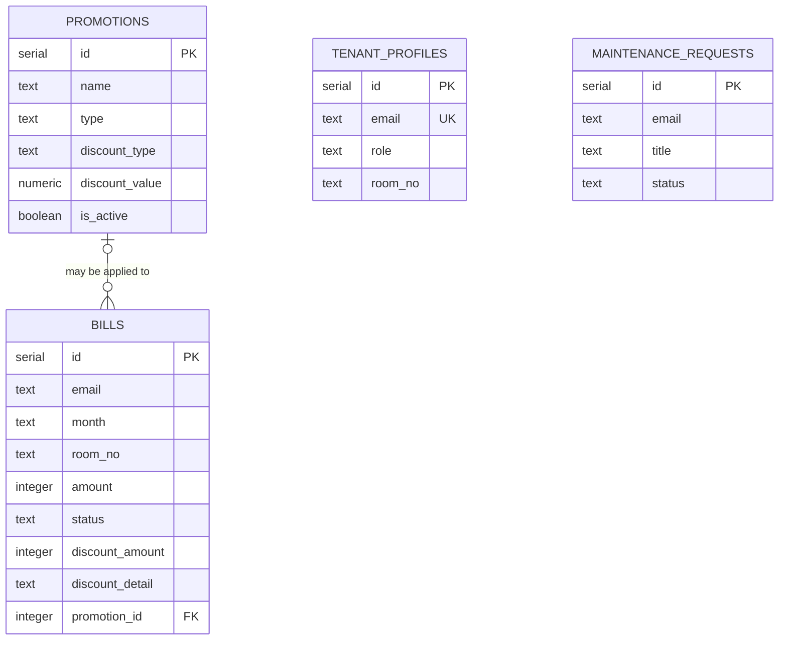

# ER Diagram

This diagram shows the tables linked by a foreign key in [`data/setup_database.sql`](../data/setup_database.sql). The standalone `appointments`, `rooms`, `announcements`, and `messages` tables have no foreign keys and are described in the schema document. The diagram includes the principal columns; the complete column specification is in [`DATABASE-SCHEMA.md`](DATABASE-SCHEMA.md).

`bills.promotion_id` is nullable, so a bill can have no promotion or one promotion. A promotion can be referenced by zero or more bills. No FK is declared from either `bills.email` or `maintenance_requests.email` to `tenant_profiles.email`; those email references are application-level only in the checked SQL.

## Tables Without Foreign Keys

`rooms`, `announcements`, `messages`, and `appointments` have no foreign keys, so they are omitted from the diagram. `occupied_rooms` is a view over `tenant_profiles`. See the schema document for their columns.
