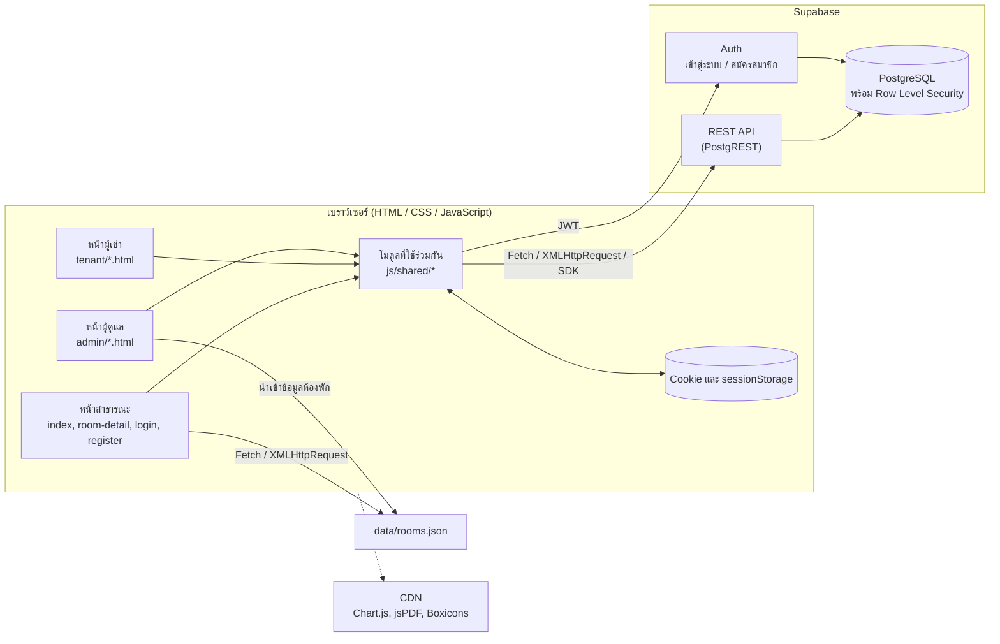
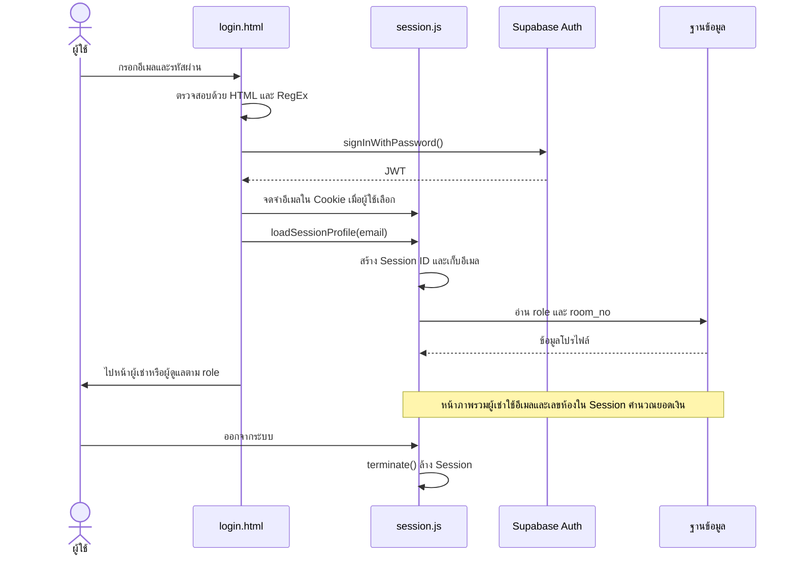
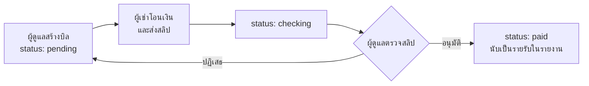

# System Architecture: Dorminator

Dorminator เป็นเว็บแอปจัดการหอพักแบบ Client-Server หน้าเว็บทั้งหมดเป็นไฟล์ HTML, CSS และ JavaScript ที่ทำงานบนเบราว์เซอร์ และเรียกใช้ Supabase เป็น Backend สำหรับฐานข้อมูลและการยืนยันตัวตน

## ภาพรวมระบบ

## ส่วนประกอบของระบบ

| ส่วน | ไฟล์ | หน้าที่ |
|---|---|---|
| หน้าเว็บ | `*.html`, `admin/`, `tenant/` | โครงสร้างหน้าแบบ Semantic HTML |
| สไตล์ | `css/style.css`, `css/admin/`, `css/tenant/` | สไตล์ส่วนกลางและรายหน้าแบบ Mobile First |
| การเชื่อมต่อ | `js/supabase-config.js` | สร้าง Supabase client |
| โมดูลร่วม | `js/shared/utils.js` | Validation, Ajax, คำนวณห้องว่าง, แบ่งหน้า, จัดรูปแบบข้อมูล |
| Session | `js/shared/session.js` | วงจร Session และ Cookie |
| สิทธิ์การเข้าถึง | `js/shared/auth-guard.js` | ตรวจสิทธิ์ผู้เช่าและผู้ดูแล, ออกจากระบบ |
| เมนู | `js/shared/components.js` | สร้าง Sidebar |
| ตรรกะรายหน้า | `js/admin/`, `js/tenant/`, `js/script.js`, `js/detail.js`, `js/auth.js` | ทำงานเฉพาะของแต่ละหน้า |
| ฐานข้อมูล | `data/setup_database.sql`, `data/migration_rubric.sql` | สร้างตาราง, Policy และ Trigger |
| ข้อมูล JSON | `data/rooms.json` | ข้อมูลตั้งต้นของห้องพัก และข้อมูลสำรองเมื่อฐานข้อมูลใช้งานไม่ได้ |

## บทบาทผู้ใช้

| บทบาท | สิ่งที่ทำได้ |
|---|---|
| บุคคลทั่วไป | ดูห้องพักและจำนวนห้องว่าง, ส่งคำขอนัดดูห้อง, สมัครสมาชิก |
| ผู้เช่า | ดูบิล, ส่งสลิป, ดาวน์โหลดใบแจ้งหนี้, แจ้งซ่อม, ดูโปรไฟล์, แชทกับผู้ดูแล |
| ผู้ดูแล | จัดการบิล, ผู้เช่า, โปรโมชั่น, แจ้งซ่อม, ประกาศ, นัดหมาย, แชท และดูรายงาน |

## ขั้นตอนการเข้าสู่ระบบและ Session

## ขั้นตอนการชำระค่าเช่า

## ความปลอดภัย

- **Row Level Security:** ผู้เช่าเข้าถึงได้เฉพาะข้อมูลของตัวเอง ส่วนผู้ดูแลตรวจสอบผ่านฟังก์ชัน `is_admin()`
- **Trigger:** ผู้เช่าเปลี่ยนสิทธิ์ เลขห้อง ยอดเงิน หรืออนุมัติบิลของตัวเองผ่าน API ไม่ได้
- **View `occupied_rooms`:** เปิดเผยเฉพาะเลขห้องให้บุคคลทั่วไป โดยไม่เปิดเผยข้อมูลผู้เช่า
- **XSS:** ข้อมูลจากฐานข้อมูลผ่าน `escapeHTML()` ก่อนแสดงผลด้วย `innerHTML`
